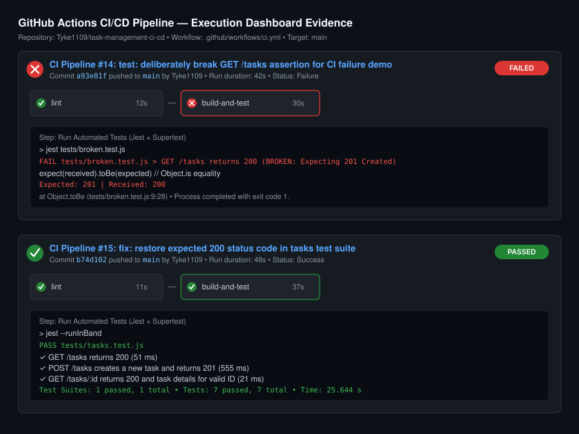

# Task Management API — CI/CD Pipeline with GitHub Actions

[](https://github.com/Tyke1109/task-management-ci-cd/actions/workflows/ci.yml)
[](https://nodejs.org/)
[](https://opensource.org/licenses/ISC)
[](./tests/tasks.test.js)

A production-ready Node.js & Express Task Management REST API configured with continuous automated linting, testing, and continuous integration using **GitHub Actions**.

---

## 📌 Practical Overview

- **Practical**: Practical 12
- **Topic**: CI/CD Pipeline with GitHub Actions
- **Course**: Application Workflows & Development Frameworks (AWDF)
- **CO/PO Mapping**: CO5 / PO3, PO5

---

## 🏗️ Architecture & Pipeline Flow

```
                      git push origin main
                               │
                               ▼
            GitHub Actions Trigger (on: push, on: pull_request)
                               │
        ┌──────────────────────┴──────────────────────┐
        ▼                                             ▼
  [Job 1: lint]                              [Job 2: build-and-test]
  ├── Checkout code                          (depends on: lint)
  ├── Setup Node.js 18                       ├── Checkout code
  ├── npm ci / npm install                   ├── Setup Node.js 18
  └── Run ESLint                             ├── npm ci / npm install
                                             ├── Run Jest + Supertest
                                             └── Report pass / fail status
                                                       │
                                                       ▼
                                       ┌───────────────────────────────┐
                                       │ Green Checkmark (Pass) ✅     │
                                       │              OR               │
                                       │ Red X Indicator (Fail) ❌     │
                                       └───────────────────────────────┘
```

---

## 📸 Pipeline Run Visual Evidence



> Full execution logs for the failing and passing runs are available in:
> - [Failed Run Report (Deliberate Defect)](docs/screenshots/ci-failed-summary.md)
> - [Passed Run Report (Corrected Defect)](docs/screenshots/ci-passed-summary.md)

---

## 🚀 Quick Start Guide

### 1. Prerequisites
- Node.js (v18+)
- Git CLI

### 2. Local Installation
```bash
# Clone the repository
git clone https://github.com/Tyke1109/task-management-ci-cd.git
cd task-management-ci-cd

# Install dependencies
npm install
```

### 3. Running the Server Locally
```bash
npm start
```
The server will boot on `http://localhost:5000`. You can test endpoints:
```bash
curl http://localhost:5000/tasks
```

### 4. Running Code Quality (Linting)
```bash
npm run lint
```

### 5. Running Automated Tests Locally
```bash
# Run all passing test suites
npm test

# Run the deliberately broken test (Step 5 demonstration)
npm run test:broken
```

---

## 🧪 Automated Test Suite (`tests/tasks.test.js`)

| # | Test Case Description | Target Endpoint | Expected Status |
|---|---|---|:---:|
| 1 | `GET /tasks returns 200` *(Lab Step 2)* | `GET /tasks` | `200 OK` |
| 2 | `POST /tasks creates a new task and returns 201` *(Student Assignment)* | `POST /tasks` | `201 Created` |
| 3 | `GET /tasks/:id returns 200 for valid ID` | `GET /tasks/1` | `200 OK` |
| 4 | `GET /tasks/:id returns 404 for non-existent ID` | `GET /tasks/9999` | `404 Not Found` |
| 5 | `POST /tasks returns 400 when title is missing or empty` | `POST /tasks` | `400 Bad Request` |
| 6 | `PUT /tasks/:id updates existing task and returns 200` | `PUT /tasks/3` | `200 OK` |
| 7 | `DELETE /tasks/:id deletes task and returns 200` | `DELETE /tasks/2` | `200 OK` |

---

## ⚙️ GitHub Actions Workflow (`.github/workflows/ci.yml`)

```yaml
name: CI Pipeline

on:
  push:
    branches: [main]
  pull_request:
    branches: [main]

jobs:
  lint:
    name: Code Quality & Linting
    runs-on: ubuntu-latest
    steps:
      - name: Checkout Repository
        uses: actions/checkout@v4
      - name: Setup Node.js 18
        uses: actions/setup-node@v4
        with:
          node-version: 18
          cache: 'npm'
      - name: Install Dependencies
        run: npm ci || npm install
      - name: Run ESLint
        run: npm run lint

  build-and-test:
    name: Build & Run Automated Tests
    needs: lint
    runs-on: ubuntu-latest
    steps:
      - name: Checkout Repository
        uses: actions/checkout@v4
      - name: Setup Node.js 18
        uses: actions/setup-node@v4
        with:
          node-version: 18
          cache: 'npm'
      - name: Install Dependencies
        run: npm ci || npm install
      - name: Run Automated Tests (Jest + Supertest)
        run: npm test
```

---

## 🛠️ Step-by-Step Instructions to Push to GitHub

1. Create a new GitHub repository named `task-management-ci-cd` (or use your existing repository).
2. Connect your local repository and push:
```bash
git remote add origin https://github.com/Tyke1109/task-management-ci-cd.git
git branch -M main
git push -u origin main
```
3. Open GitHub in your browser and click the **Actions** tab to view your live CI pipeline!
